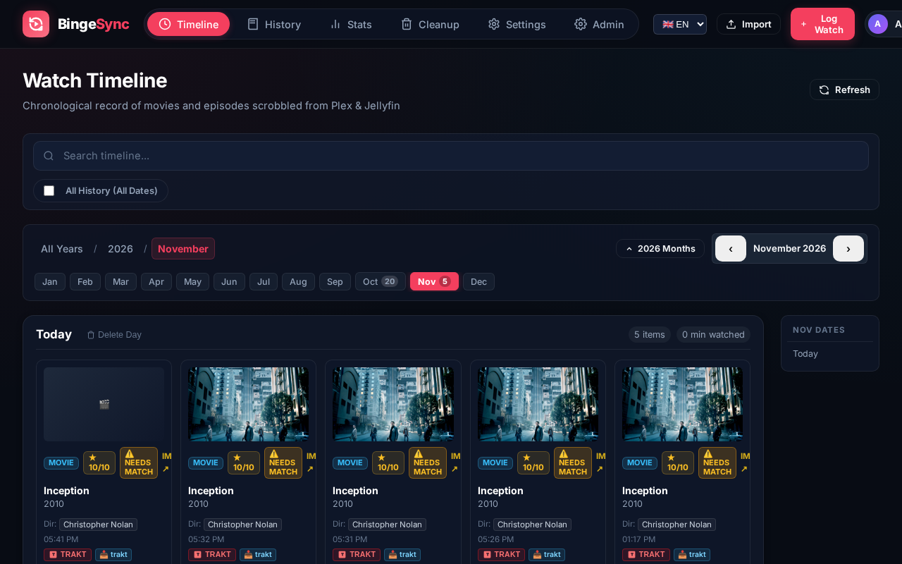
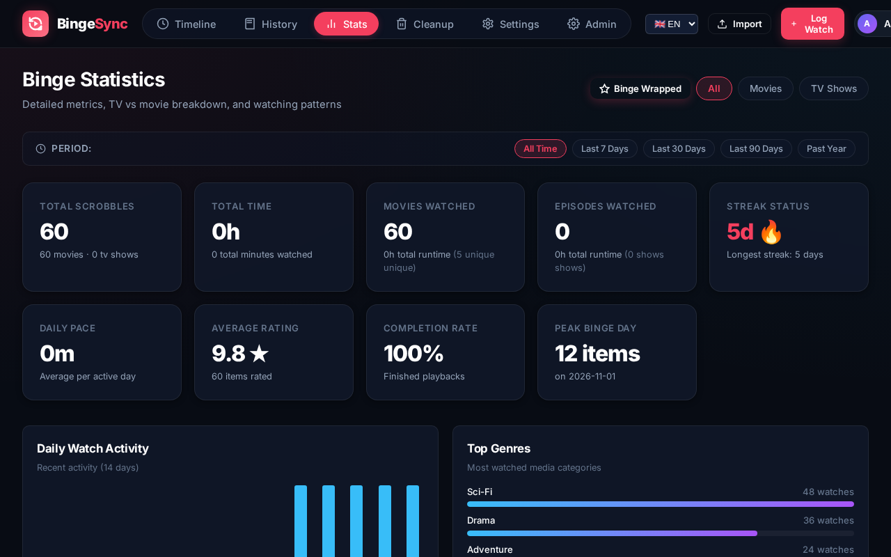
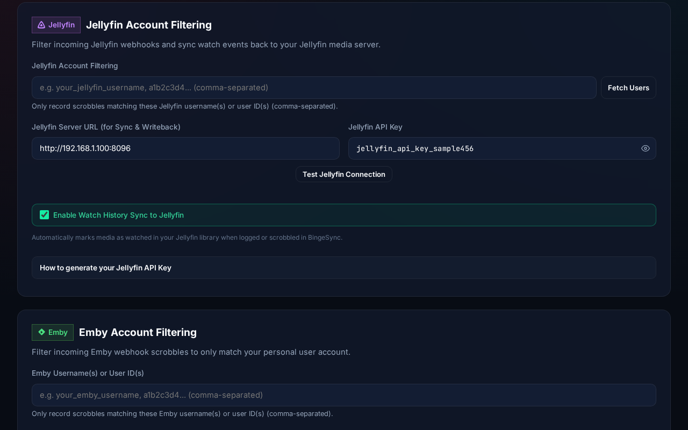
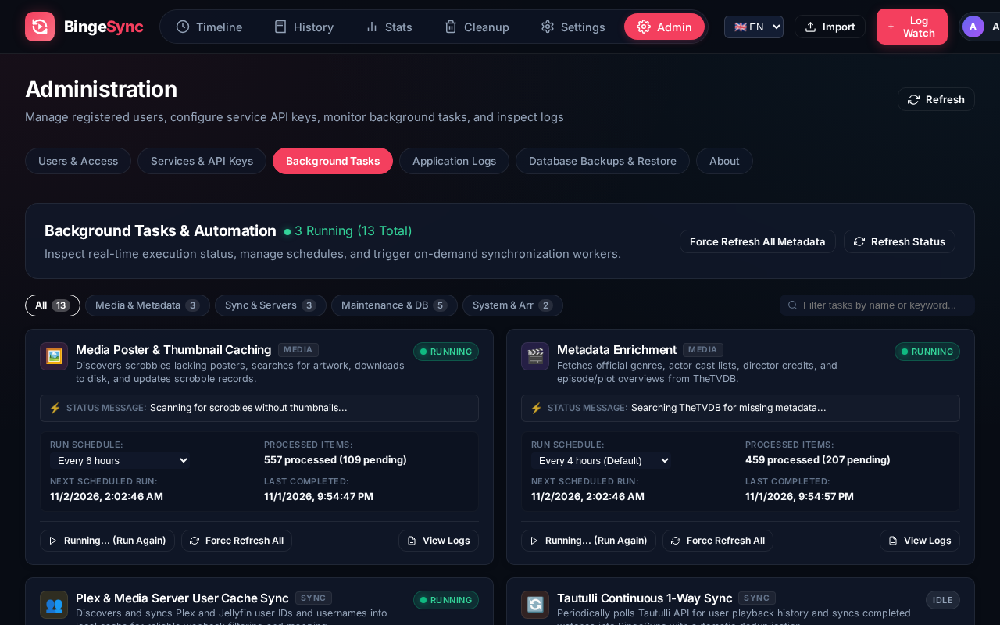

# BingeSync

[](https://www.rust-lang.org/)
[](https://www.sqlite.org/)
[](https://www.docker.com/)
[](LICENSE)

BingeSync is a lightweight, self-hosted media tracker, synchronization engine, and Trakt.tv alternative. It automatically captures playback from **Plex**, **Jellyfin**, and **Emby** webhooks into an embedded SQLite database (WAL mode) and delivers a high-performance web interface with interactive timelines, viewing analytics, duplicate watch pruning, ratings management, and bidirectional media server synchronization.

---

## Screenshots

| Interactive Timeline View | Viewing Analytics & 7x24 Heatmap |
| :---: | :---: |
|  |  |

| Connected Services & Media Server Sync | Admin Background Tasks & Monitoring |
| :---: | :---: |
|  |  |

---

## Key Features

- **Plex, Jellyfin & Emby Webhooks**: Captures playback start, pause, resume, progress, and completed scrobbles with configurable playback completion thresholds and account/UUID filtering.
- **Cross-Server Sync (Plex $\leftrightarrow$ Jellyfin)**: Synchronizes watched status back to both Plex and Jellyfin servers automatically or on-demand, keeping disparate media servers in lockstep.
- **Multi-User Isolation**: Strictly scoped watch histories, user settings, active sessions, and personal webhook tokens for every account.
- **Rating Threshold Filters**: Filter watch history and timeline by minimum star rating thresholds (10/10, 9+ stars, 8+ stars down to 1+ star, rated, or unrated) combined with media type pills.
- **Duplicate Watch Detector & Cleanup**: Group identical scrobbles within configurable time windows (1h to 72h) and prune redundant entries using *Keep Oldest* or *Keep Newest* strategies.
- **Custom Tags & Personal Review Notes**: Annotate scrobbles with searchable tags (e.g. `rewatch`, `imax`, `favorites`) and personal review notes with one-click filter chips.
- **Timeline & History**: Daily grouped watch logs with date scrubber, search across all history, batch selection and deletion, and rich filters for genres, directors, cinematographers, and actors.
- **Viewing Heatmap & Annual Review (Binge Wrapped)**: 7x24 weekly hourly viewing density heatmap matrix, top movies/shows charts, streaks, and an interactive annual "Binge Wrapped" review modal.
- **Metadata Enrichment & Poster Caching**: Background enrichment of plot overviews, genres, cast, and crew using **The Movie Database (TMDB)** or **TheTVDB (v4)**, with disk-based poster caching.
- **Trakt.tv & Tautulli Imports**: Import watch history and ratings from Trakt export files (multi-file ZIP, JSON, CSV) or connected Tautulli instances with automatic deduplication.
- **Arr Library Cleanup**: Cross-reference watched items against Radarr and Sonarr libraries to identify deletion candidates, calculate reclaimable disk space, and trigger media removal.
- **Automated Backups & Data Export**: Point-in-time SQLite database backups with 7-day retention and pre-restore snapshots, plus one-click user data export to a clean ZIP archive (scrobbles CSV, JSON, and ratings).
- **Enterprise Authentication**: OpenID Connect (OIDC) SSO with PKCE, OpenID Back-Channel Logout 1.0 for instant session termination upon access revocation, group role mapping, local dev login, and personal scoped API keys.
- **Single-Binary Delivery**: Rust backend with embedded web assets (`rust-embed`) and zero external runtime dependencies.
- **Interactive API Documentation**: Embedded OpenAPI 3.0 specification served at `/api/v1/openapi.json` and interactive Swagger UI at `/docs`.

---

## Quick Start

### Docker Compose

```yaml
services:
  bingesync:
    image: bingesync:latest
    build: .
    container_name: bingesync
    restart: unless-stopped
    ports:
      - "8080:8080"
    environment:
      - HOST=0.0.0.0
      - PORT=8080
      - APP_URL=http://localhost:8080
      - DATABASE_URL=sqlite:///data/bingesync.db?mode=rwc
      - JWT_SECRET=change-this-to-a-random-secret
      - DEV_LOGIN_ENABLED=true
    volumes:
      - bingesync_data:/data
      - bingesync_backups:/backup

volumes:
  bingesync_data:
    driver: local
  bingesync_backups:
    driver: local
```

Start the container:

```bash
docker compose up -d
```

Access the web interface at `http://localhost:8080`.

---

## Cross-Server Sync: Plex $\leftrightarrow$ Jellyfin

Many home media enthusiasts run both a **Plex Media Server** and a **Jellyfin** (or Emby) instance simultaneously. Keeping watch history in sync between the two has traditionally required complex external scripts. **BingeSync solves this natively as a lightweight central hub**:

```
                  ┌────────────────────────┐
                  │       BingeSync        │
                  │   (SQLite Central Hub) │
                  └──────┬──────────┬──────┘
       Plex Webhook      │          │      Jellyfin Webhook
     (Media Watched)     ▼          ▼     (Media Watched)
  ┌────────────────────────┐      ┌────────────────────────┐
  │   Plex Media Server    │      │  Jellyfin Media Server │
  │   (Automatic Writeback)│◄────►│  (Automatic Writeback) │
  └────────────────────────┘      └────────────────────────┘
```

1. **Automatic Bi-directional Writeback**: Watch on Plex $\rightarrow$ BingeSync marks the item played on Jellyfin. Watch on Jellyfin $\rightarrow$ BingeSync marks it watched on Plex (`/:/scrobble`).
2. **Per-Service Controls**: Enable watch history sync independently for Plex, Jellyfin, or both under **User Settings** $\rightarrow$ **Connected Services**.
3. **Scheduled & On-Demand Sync**: An integrated background worker runs every 4 hours to catch up on offline watches, with manual on-demand triggers available anytime.

---

## Documentation & Wiki Guides

Detailed setup instructions, configuration references, and troubleshooting guides are available in the **[BingeSync Wiki](wiki/Home.md)**:

* **[Setup & Configuration Guide](wiki/Setup-and-Configuration.md)**: Reverse proxy configs (Nginx, Caddy, Traefik, subpath `/bingesync`), complete environment variables table, and first-run wizard.
* **[Media Server Webhooks & Sync Guide](wiki/Media-Server-Webhooks-and-Sync.md)**: Step-by-step guides for Plex, Jellyfin, and Emby webhooks, token extraction, and Tautulli continuous sync.
* **[Authentication & OIDC Guide](wiki/Authentication-and-OIDC.md)**: SSO provider setup (Authentik, Keycloak, Authelia, Google, Okta), OIDC Back-Channel Logout, and scoped API keys.
* **[Integrations & Power Tools](wiki/Integrations-and-Tools.md)**: Radarr/Sonarr library cleanup, Trakt/Tautulli imports, duplicate detector, and outbound webhooks (Discord, Telegram, ntfy, Gotify).
* **[Troubleshooting Guide](wiki/Troubleshooting-Guide.md)**: Resolving webhook username mismatches, SQLite database lock contention, cookie security flags, and inspecting live diagnostic logs.

---

## REST API

Interactive Swagger documentation is available at `/docs` (or `/swagger`). The OpenAPI 3.0 specification is served at `/api/v1/openapi.json`.

---

## Development and Testing

```bash
# 1. Build frontend
cd web && npm run build && cd ..

# 2. Run backend
cargo run

# 3. Run backend integration tests (62 tests)
cargo test

# 4. Run Playwright browser E2E tests (46 tests)
cd web && npx playwright test
```

---

## Attributions

- Metadata, plot outlines, and cast information can be enriched via [TheTVDB](https://thetvdb.com) or [The Movie Database (TMDB)](https://www.themoviedb.org).

---

## License

This project is licensed under the **GNU General Public License v3.0 (GPL-3.0)**. Any software or project that incorporates or uses BingeSync must also be open source under the GPL-3.0. See the [LICENSE](LICENSE) file for the full license text.
